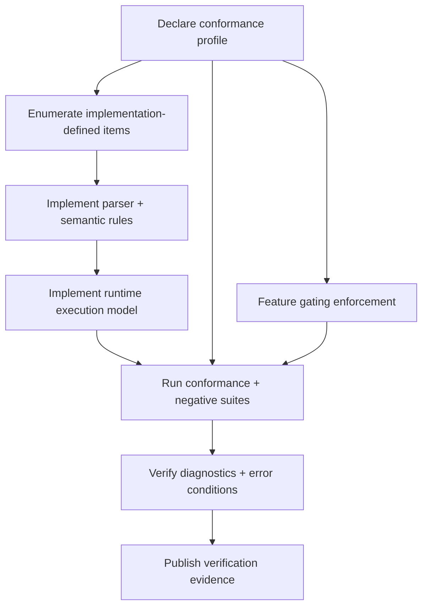
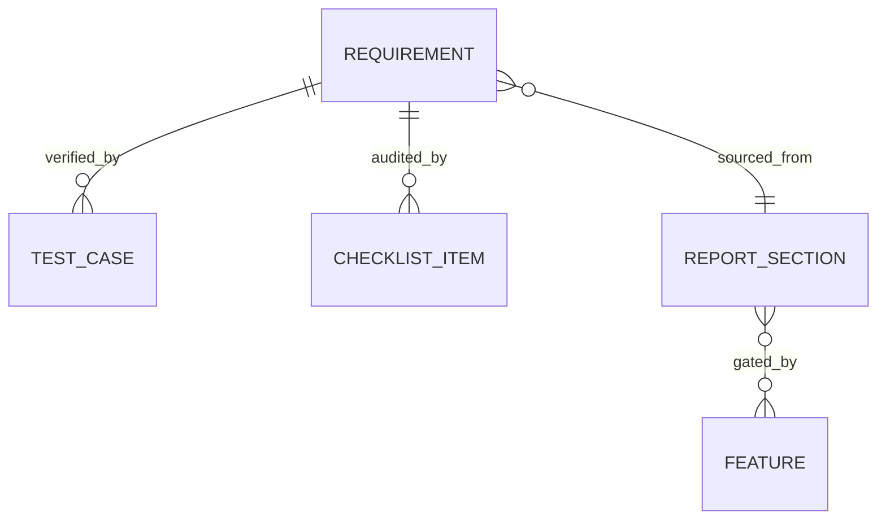

# Extracting Implementable, Testable Requirements from ISO/IEC 39075:2024 GQL

## Table of contents
- Executive summary  
- Source report and section map  
- Requirement extraction method and traceability scheme  
- Implementation requirements register  
- Verification checklist and traceability mappings  
- Verification flow diagrams and verification strategy  
- Inputs needed for complete enumeration and automation  

## Executive summary
This report extracts implementation requirements from entity["book","ISO/IEC 39075:2024","gql standard 2024"] (Database languages — GQL) and organizes them so an implementation can be verified directly against the standard’s clause structure and conformance model. fileciteturn0file0

Two practical realities matter up front:

First, the standard’s normative requirements are distributed across (a) general clauses (concepts, environments, execution, types, diagnostics), (b) formal Syntax/General/Conformance Rules, and (c) the conformance framework (minimum conformance + optional features + “Without Feature …” constraints). A correct “requirements extraction” therefore has to treat: **(1) unconditional implementation obligations**, **(2) conditional obligations gated by feature claims**, and **(3) requirements to explicitly define/document implementation-defined elements**. fileciteturn0file0

Second, the standard explicitly pre-declares a large surface of **implementation-defined** knobs (Annex B). In this edition, Annex B enumerates a long list of implementation-defined codes (IA/ID/IL/IW/IV…) that must be decided and documented for a concrete implementation. In a quick structural pass over Annex B, there are on the order of a hundred distinct implementation-defined codes (one count on this PDF yields 116 distinct codes), which means “conforming implementation” is not just code—it also includes a **published conformance profile** and **published implementation-defined decisions**. fileciteturn0file0

Additionally, the report includes the standard’s officially published “digital artifacts” index (grammar, features and conformance metadata). These artifacts are explicitly offered for implementers and are part of the verification story (especially for parser generation and feature matrices). citeturn1view0

## Source report and section map
### Source acquisition and appendices
Primary source: the provided PDF of ISO/IEC 39075:2024 (English). fileciteturn0file0

Official appendices / electronic inserts (“digital artifacts”) are hosted on the ISO maintenance portal (same edition and language). The portal lists: a BNF grammar in text and XML, and XML artifacts for conditions, implementation-defined elements, implementation-dependent elements, and features. citeturn1view0  
One artifact (the plain-text BNF grammar) is directly retrievable and is described explicitly as a parser-generation aid for implementers. citeturn2view3

### Implementation-relevant clause map
For implementation verification, the following clause clusters are the highest-yield anchors (this is not a full table-of-contents reproduction, but a verification-oriented map of “where requirements hide”). fileciteturn0file0

| Cluster | Why it matters to implementation | Examples of requirements found there |
|---|---|---|
| Clause 4 (Concepts) | Defines the execution model, sessions/transactions, diagnostics, types, and baseline environment rules | Session defaults, transaction equivalence, privilege enforcement, diagnostics field naming |
| Clause 5 (Conformance, syntax & semantics framework) | Defines how “shall”/rules operate and case-insensitivity of keywords | Keyword case folding; rule interpretation conventions |
| Clause 6 and later (Syntax/General/Conformance Rules for constructs) | Where “Without Feature … shall not …” constraints appear | Rejecting constructs not allowed unless a feature is claimed |
| Clause 24 (Conformance) + Annex A | Defines minimum conformance, optional feature claims, and obligations for implementations | “shall execute conforming programs”, “shall reject required errors”, feature-claim structure |
| Annex B (Implementation-defined) | Enumerates implementation-defined decisions that must be defined for a concrete implementation | “implementation-defined … shall be defined for each particular implementation” |
| Annex C (Implementation-dependent) | Enumerates intentionally underspecified behaviors that may vary | Test harness must tolerate specified variability |

## Requirement extraction method and traceability scheme
### What counts as an “implementation requirement”
This report treats **implementation requirements** as any statement that, when operationalized, can be verified against an implementation. They fall into three categories:

- **Obligations**: normative “shall/shall not” constraints on implementation behavior (e.g., error raising, acceptance/rejection of programs, required minimum capacities). fileciteturn0file0  
- **Conditional obligations**: obligations that apply only when a feature is claimed or not claimed (“Without Feature FEAT … shall not …”). These are still implementation requirements because the engine must enforce the constraint based on its declared/selected conformance profile. fileciteturn0file0  
- **Declaration obligations**: requirements that the implementation must *define and document* implementation-defined elements in its conformance claim and/or documentation. Annex B and Clause 24.5.2 make this unavoidable. fileciteturn0file0

### Traceability IDs and referencing rules
This report assigns each requirement a stable ID:

- **Format**: `GQL-39075-RQ-####` (sequential)  
- **Source reference**: clause/subclause + printed page (if available) + PDF page  
- **Verification linkage**: each requirement is mapped to:
  - checklist item(s) `GQL-39075-CK-###`
  - test case(s) `GQL-39075-TC-###`

### Practical extraction workflow
To fully enumerate requirements (beyond the curated register below), the repeatable approach is:

1. Build a section index from the PDF’s contents plus clause headings. fileciteturn0file0  
2. Extract all candidate requirement statements by scanning for:
   - `shall`, `shall not`, `shall never`, and conditional “When … is detected, … is raised …” constructions. fileciteturn0file0  
   - “Without Feature … conforming GQL language shall not …” Conformance Rules. fileciteturn0file0  
   - explicit “implementation-defined (I*###)” and “implementation-dependent” markings, using Annex B/C as the authoritative index list. fileciteturn0file0  
3. Normalize each requirement into a testable statement:
   - define measurable acceptance criteria
   - define required inputs/outputs and error codes/status artifacts
   - define dependencies (feature IDs, privilege model, Unicode version claims, etc.) fileciteturn0file0  
4. Generate traceability:
   - requirement ↔ clause
   - requirement ↔ checklist
   - requirement ↔ test(s)

### Standards that directly affect conformance testing
Several external standards are normatively wired into requirements and therefore into acceptance criteria and test data. The most implementation-impacting are: fileciteturn0file0  
- entity["book","The Unicode Standard","unicode consortium standard"] (minimum claimed version constraints and character repertoire rules) fileciteturn0file0  
- entity["book","Unicode Technical Standard #10","unicode collation algorithm"] (UNICODE collation option) fileciteturn0file0  
- entity["book","Unicode Standard Annex #15","unicode normalization forms"] (normalization forms) fileciteturn0file0  
- entity["book","Unicode Standard Annex #31","unicode identifier syntax"] (claimed in minimum conformance) fileciteturn0file0  
- entity["book","Unicode Standard Annex #36","unicode security confusables"] (recommended context for confusable handling) fileciteturn0file0  
- entity["book","ISO 8601-1:2019","date time representations"] and entity["book","ISO 8601-2:2019","extensions date time"] (temporal literal formats and semantics references) fileciteturn0file0  
- entity["book","ISO/IEC 9075-2:2023","sql foundation 2023"] (SQL temporal literal formats are allowed alternatives) fileciteturn0file0  
- entity["book","IEEE Std 754-2019","floating point arithmetic"] (referenced for optional floating-point feature behavior) fileciteturn0file0  

## Implementation requirements register
### Summary table of requirements
This summary table is for fast scoping, triage, and planning. The detailed register immediately follows. fileciteturn0file0

| Req ID | Source (clause; printed p; PDF p) | Priority | Short name |
|---|---:|---|---|
| GQL-39075-RQ-0001 | 24.5.1; p516; PDF p532 | High | Execute conforming programs |
| GQL-39075-RQ-0002 | 24.5.1; p516; PDF p532 | High | Reject required-detectable errors |
| GQL-39075-RQ-0003 | 24.5.1; p516; PDF p532 | Medium | Provide GQL Flagger when extending |
| GQL-39075-RQ-0004 | 24.5.2; p516; PDF p532 | High | Conformance claim completeness |
| GQL-39075-RQ-0005 | 24.2; p513; PDF p529 | High | Minimum conformance feature baseline |
| GQL-39075-RQ-0006 | 24.2; p513; PDF p529 | High | Unicode/UTS/UAX minimum claim rules |
| GQL-39075-RQ-0007 | 24.2; p513; PDF p529 | High | Minimum supported property value types |
| GQL-39075-RQ-0008 | 4.7.1; p38; PDF p54 | High | Source text character repertoire |
| GQL-39075-RQ-0009 | 4.16.3.2; p83; PDF p99 | Medium | Exactly one default collation |
| GQL-39075-RQ-0010 | 4.16.3.1; p82; PDF p98 | Medium | Character string max length ≥ 16383 |
| GQL-39075-RQ-0011 | 4.16.3.1; p82; PDF p98 | Low | Confusable detection: never self-confusable |
| GQL-39075-RQ-0012 | Clause 6 syntax rule; p105; PDF p121 | Medium | Confusable identifiers raise 42004 |
| GQL-39075-RQ-0013 | 4.16.6.1; p90; PDF p106 | Medium | Temporal instants use UTC‑SLS |
| GQL-39075-RQ-0014 | 4.16.6.2/6.3; p91–92; PDF p107–108 | Medium | Temporal literal formats ISO 8601 or SQL |
| GQL-39075-RQ-0015 | 4.16.6.4; p93; PDF p109 | Medium | Seconds precision IL024 ≥ 6 |
| GQL-39075-RQ-0016 | 4.16.4; p84; PDF p100 | Medium | Bytestring max length ≥ 65534 bytes |
| GQL-39075-RQ-0017 | 4.5.2.1; p34; PDF p50 | Low | Default session params start “_” |
| GQL-39075-RQ-0018 | 4.9.2; p47; PDF p63 | High | Diagnostic record field naming + GA08 gating |
| GQL-39075-RQ-0019 | 4.2.4.2; p24; PDF p40 | High | Privilege enforcement raises 42000 |
| GQL-39075-RQ-0020 | 4.2.3.2; p23; PDF p39 | High | Connection-loss exceptions 40003 / 08007 |
| GQL-39075-RQ-0021 | 4.6.2; p37; PDF p53 | Medium | Impl-defined transactions behave like explicit |
| GQL-39075-RQ-0022 | 5.3.2.2; p100; PDF p116 | Low | Keywords are case-insensitive |
| GQL-39075-RQ-0023 | Clause 6 conformance rule; p106; PDF p122 | Medium | Without GT01: reject explicit transaction commands |
| GQL-39075-RQ-0024 | Annex B intro; p555; PDF p571 | High | Implementation-defined characteristics must be defined |

### Detailed requirements table
Each requirement below includes: exact excerpt (short verbatim excerpt), clause/page, interpretation, acceptance criteria, priority + rationale, dependencies, inputs/outputs, and verification steps/test cases. fileciteturn0file0

| Traceability ID | Requirement excerpt (verbatim excerpt) | Source reference | Interpretation | Acceptance criteria (measurable) | Priority (rationale) | Dependencies | Inputs / Outputs | Test cases / verification steps |
|---|---|---|---|---|---|---|---|---|
| GQL-39075-RQ-0001 | “shall correctly translate and execute all GQL-programs…” | 24.5.1; printed p516; PDF p532 fileciteturn0file0 | If a program conforms to the language **and** your implementation-defined profile, it must run correctly. | For a conformance suite of syntactically+semantically conforming programs under your declared profile: execution results match spec-defined outcomes (including result sets/status) with zero “implementation bug” deviations. | High (baseline conformance: if false, “conforming implementation” fails). | Your declared conformance profile (minimum + optional features) and your published implementation-defined decisions. | In: GQL-program, session context, catalog/data. Out: execution outcome + status objects + data changes. | TC-001: Run conformance suite for minimum conformance and each claimed feature; diff results against oracle. |
| GQL-39075-RQ-0002 | “shall reject all GQL-programs that contain errors whose detection is required…” | 24.5.1; p516; PDF p532 fileciteturn0file0 | For any error the spec requires you to detect, you must reject (not “best effort”). | For each required-detectable error class: submission results in rejection with an exception condition; no partial execution beyond what spec permits. | High (prevents silent mis-execution and invalid portability claims). | Parser + semantic analyzer must implement “required detection” set. | In: invalid program. Out: exception + diagnostics (if GA08 claimed). | TC-002: Negative suite of required errors; verify rejection and correct condition class. |
| GQL-39075-RQ-0003 | “shall provide a GQLFlagger” (when extending) | 24.5.1; p516; PDF p532 fileciteturn0file0 | If you support optional features or extra non-standard facilities, you must provide a flagger tool/mode that identifies non-standard language. | With extensions enabled, the flagger detects and flags all non-standard constructs that your engine can still process. | Medium (mandatory only for implementations that extend; still important for portability tooling). | Presence of optional features and/or extensions beyond the spec. | In: GQL source. Out: flags/warnings listing non-standard parts. | TC-003: Feed extension-using programs; ensure flagger reports all non-standard constructs; ensure conforming programs pass unflagged. |
| GQL-39075-RQ-0004 | “A claim of conformance… shall include… [and] the definition for every… implementation-defined.” | 24.5.2; p516; PDF p532 fileciteturn0file0 | Conformance is not only runtime behavior; you must publish a complete conformance claim and fill in implementation-defined items. | Published conformance statement includes: (a) minimum conformance, (b) optional feature claims, (c) definitions for every in-scope implementation-defined element/action (Annex B list). | High (without this, conformance cannot be assessed or reproduced). | Annex B list of implementation-defined items; your feature set. | In: documentation/config. Out: conformance profile artifact and implementation-defined definitions. | TC-004: Audit conformance claim document; cross-check every referenced “I*###” is defined and matches runtime behavior. |
| GQL-39075-RQ-0005 | “A claim of minimum conformance shall also include… [GG01] or [GG02] … with at least one of [GG20..GG23].” | 24.2; p513; PDF p529 fileciteturn0file0 | Minimum conformance requires declaring at least one baseline graph-type feature path and associated element-type key labeling mode(s). | Conformance profile asserts GG01 **or** GG02 plus at least one of GG20–GG23 (per the standard’s structure). | High (minimum conformance gate). | Feature registry and your graph type system support. | In: conformance claim. Out: verifiable feature list and runtime behavior consistent with it. | TC-005: Verify declared features exist; run feature-specific syntax/semantics tests. |
| GQL-39075-RQ-0006 | “claimed version… shall not be less than ‘13.0.0’.” | 24.2; p513; PDF p529 fileciteturn0file0 | Minimum conformance requires a Unicode baseline (Unicode + synchronized UTS/UAX versions). | Conformance profile states Unicode version ≥ 13.0.0 and synchronized versions of the referenced UTS/UAX documents; runtime behavior matches the claimed version for identifiers/collation/normalization where relevant. | High (affects parsing, identifiers, collation, confusables, portability). | Unicode library versioning and policy; identifier rules; normalization/collation behavior. | In: identifiers, string operations, grammar/tokenization. Out: deterministic parsing and string behavior consistent with claim. | TC-006: Validate documentation claim; run identifier and normalization tests derived from Unicode version behaviors. |
| GQL-39075-RQ-0007 | “At minimum, this set shall include: [STRING/VARCHAR, BOOLEAN, SIGNEDINTEGER, FLOAT].” | 24.2; p513; PDF p529 fileciteturn0file0 | Even at minimum conformance, property values must support at least these value-type families. | You can create/store/query properties using these types; type descriptors and casts behave per spec; round-trip tests succeed. | High (core interoperability surface). | Type system; property storage/encoding. | In: property writes/reads. Out: stored typed property values and correct query results. | TC-007: Create nodes/edges with each type; query and compare; assert type-preserving behavior. |
| GQL-39075-RQ-0008 | “character repertoire shall be an implementation-defined… subset… [of Unicode] that includes every <GQL language character>…” | 4.7.1; p38; PDF p54 fileciteturn0file0 | Your parser’s accepted source-text character set must be declared and must include required language characters and any other supported characters. | Documented repertoire exists; parser accepts all required characters; unsupported characters are representable via escapes where required; inputs outside repertoire are rejected/escaped per spec. | High (parsing portability; security implications). | Implementation-defined IV001; escape processing rules. | In: source text. Out: token stream / parse tree or syntax error. | TC-008: Feed source with required chars; feed unsupported chars and verify escape handling / rejection per profile. |
| GQL-39075-RQ-0009 | “defines exactly one default collation…” | 4.16.3.2; p83; PDF p99 fileciteturn0file0 | Comparisons of character strings must use one and only one default collation chosen from allowed options (or a declared custom). | Implementation exposes/records chosen default collation; string comparisons are consistent with the declared choice under test corpus. | Medium (critical for portability; can be deferred if comparisons not yet supported). | Implementation-defined ID022; Unicode collation algorithm if UNICODE selected. | In: string comparisons/sorts. Out: deterministic ordering. | TC-009: Compare/sort known string sets; validate output matches declared collation expectations. |
| GQL-39075-RQ-0010 | “maximum length… shall be… 16383 characters.” | 4.16.3.1; p82; PDF p98 fileciteturn0file0 | You must support strings at least this long (even if you support longer). | Store and process a 16,383-character string without error; if you cap, cap is ≥ 16,383. | Medium (capacity baseline; affects storage and memory). | IL013 (max length definition). | In: long string literal / parameter. Out: preserved value, correct length, correct comparisons. | TC-010: Insert/assign 16,383-char string; verify retrieval and length; attempt boundary cases. |
| GQL-39075-RQ-0011 | “shall never be determined to be visually confusable with itself.” | 4.16.3.1; p82; PDF p98 fileciteturn0file0 | If you implement visual-confusable detection, it must not flag a string as confusable with itself. | Confusable-check API/path never reports `confusable(s, s)=true`. | Low (narrow condition; mostly correctness edge-case). | IW014 mechanism choice. | In: string value(s). Out: confusable decision / flags. | TC-011: Run confusable check for identical strings and assert false. |
| GQL-39075-RQ-0012 | “if… visually confusable… then an exception condition is raised… (42004).” | Clause 6 (<GQL-program>); p105; PDF p121 fileciteturn0file0 | The engine must detect visually confusable identifiers within a program and raise the specified exception. | Given two identifiers that are visually confusable under IW014, the program is rejected with condition 42004 (or the standard’s named condition). | Medium (security + portability; depends on IW014 policy). | IW014 confusable mechanism; identifier parsing. | In: program text containing two confusable identifiers. Out: raised exception condition. | TC-012: Use known confusable pair (e.g., mixed-script lookalikes); verify rejection and condition code. |
| GQL-39075-RQ-0013 | “timescale… shall conform to UTC-SLS.” | 4.16.6.1; p90; PDF p106 fileciteturn0file0 | Temporal instant semantics must be on the UTC‑SLS time scale. | Documented temporal model references UTC‑SLS; tests involving leap seconds and offsets behave consistently with UTC‑SLS constraint (within what spec defines). | Medium (affects temporal correctness; often implemented via standard time libs). | Temporal subsystem; timestamp interpretation. | In: temporal values. Out: computed instants and comparisons. | TC-013: Validate temporal model documentation; run temporal comparison tests including edge cases. |
| GQL-39075-RQ-0014 | “format of temporal… literals shall be either… ISO 8601… or… ISO/IEC 9075-2…” | 4.16.6.2–6.3; p91–92; PDF p107–108 fileciteturn0file0 | Temporal literals accepted by the language must conform to one of the permitted format families. | Parser accepts the supported literal formats and rejects malformed ones; behavior is documented (which of the alternatives are supported if multiple). | Medium (parser correctness). | Literal grammar; ISO 8601 and SQL literal format support. | In: temporal literal tokens. Out: parsed temporal typed value or syntax error. | TC-014: Provide ISO 8601 and SQL-format literals per spec; ensure accepted when supported; verify strict rejection of invalid forms. |
| GQL-39075-RQ-0015 | “maximum seconds precision… not less than 6.” | 4.16.6.4; p93; PDF p109 fileciteturn0file0 | For temporal values containing seconds, support at least microsecond precision (or better). | Declared seconds precision IL024 ≥ 6; parsing and formatting preserve ≥ 6 fractional second digits where applicable. | Medium (data fidelity). | IL024; temporal type encoding. | In: timestamps/durations with fractions. Out: stored values and comparisons. | TC-015: Parse/store values with 6 fractional digits; round-trip without loss. |
| GQL-39075-RQ-0016 | “maximum length… shall be… 65534 bytes.” | 4.16.4; p84; PDF p100 fileciteturn0file0 | You must support bytestrings at least this long. | Insert/assign a 65,534‑byte bytestring without error; cap (if any) is ≥ 65,534. | Medium (capacity baseline affecting storage). | IL013 (bytestring max length), ID023 (preferred bytestring type name choice). | In: bytestring literal/parameter. Out: stored value. | TC-016: Insert 65,534 bytes; retrieve and validate length/content. |
| GQL-39075-RQ-0017 | “default session parameters start with underscore (‘_’).” | 4.5.2.1; p34; PDF p50 fileciteturn0file0 | If you provide implementation-defined default session parameters, their names must be reserved in the “_” namespace. | Any implementation-defined default session parameter name begins with `_`; user-defined names do not collide. | Low (namespace hygiene; reduces cross-implementation collisions). | ID049 default session parameters. | In: session initialization. Out: default session parameter dictionary. | TC-017: Enumerate default session parameters; assert naming convention. |
| GQL-39075-RQ-0018 | “fields shall start with underscore (‘_’)… Without Feature GA08… shall not contain a diagnostic record.” | 4.9.2; p47; PDF p63 fileciteturn0file0 | Diagnostic record extension fields must be under `_…`; and if GA08 is not claimed, diagnostics records must not appear. | (a) Any additional diagnostic record field name begins `_`. (b) With GA08 disabled in profile, returned status objects never include diagnostic record payloads. | High (conformance gating + predictable diagnostics surfaces). | Feature GA08; ID017 diagnostic record extension fields; status object architecture. | In: raised conditions. Out: status object(s) and diagnostic record(s) if allowed. | TC-018: Inject errors; verify diagnostic fields naming; run with GA08 off and confirm no diagnostic record present. |
| GQL-39075-RQ-0019 | “If… not permitted… then an exception condition is raised… (42000).” | 4.2.4.2; p24; PDF p40 fileciteturn0file0 | Privilege enforcement is mandatory: unauthorized operations must raise the specified access-rule exception. | For each privileged operation, when executed without required privilege, engine raises 42000 and performs no unauthorized state change. | High (security and correctness). | ID003 privilege set definition; auth identifier plumbing. | In: request under a principal lacking privilege. Out: 42000 exception + no state changes. | TC-019: Attempt restricted ops under insufficient privileges; assert exception and no side effects. |
| GQL-39075-RQ-0020 | “When… connection failure is detected… exception… (40003)… [and] (08007).” | 4.2.3.2; p23; PDF p39 fileciteturn0file0 | If the engine detects a connection loss during statement execution or commit, it must raise the specified exception conditions indicating unknown completion/resolution. | In controlled fault injection: (a) drop connection mid-statement → 40003 raised; (b) drop connection during commit → 08007 raised. | High (transaction correctness & client safety). | Transport layer; fault detection; transaction state model. | In: in-flight request/commit. Out: exception signaling unknown outcome. | TC-020: Fault injection harness to sever connection at defined points; validate raised conditions and client-visible state. |
| GQL-39075-RQ-0021 | “behavior… shall be the same as transactions started with… <start transaction>… terminated with… <end transaction>.” | 4.6.2; p37; PDF p53 fileciteturn0file0 | If your system has auto-start/auto-rollback or other impl-defined transaction boundaries, they must behave equivalently to explicit transaction commands. | Compare an impl-defined transaction boundary flow to explicit start/end on same operations: commit/rollback semantics, visibility, and final state match. | Medium (important for correctness; complex to test). | IW004 auto transaction start/termination; IW005 termination status exposure. | In: operations run under auto vs explicit transactions. Out: equivalent persisted state and status. | TC-021: Run mirrored workloads under auto and explicit transaction handling; diff catalog/data outcomes. |
| GQL-39075-RQ-0022 | “keyword… spelled… lower-case… is identical… to ‘MATCH’.” | 5.3.2.2; p100; PDF p116 fileciteturn0file0 | Keywords are case-insensitive in GQL source (within the defined folding; effectively ASCII case folding for keywords). | Parser accepts mixed-case keywords everywhere a keyword is expected; semantics identical to uppercase token. | Low (straightforward parser requirement). | Lexer/tokenizer rules. | In: mixed-case keyword source. Out: same parse tree as uppercase. | TC-022: Submit programs with randomized-casing keywords; ensure equivalent parse/execution. |
| GQL-39075-RQ-0023 | “Without Feature GT01… shall not contain a <start transaction>… or <end transaction>.” | Clause 6 conformance rules; p106; PDF p122 fileciteturn0file0 | If GT01 is not claimed/supported, explicit transaction commands must be rejected as non-conforming. | Under a conformance profile that does not include GT01, parsing/flagging rejects start/end transaction commands as non-conforming (and/or flagger flags them). | Medium (feature-gated portability constraint). | Feature GT01; conformance profile enforcement. | In: program using start/end transaction. Out: rejection or nonconformance flagging per rules. | TC-023: Set profile without GT01; attempt explicit transaction commands; verify rejection/flagging. |
| GQL-39075-RQ-0024 | “implementation-defined… shall be defined for each particular GQL-implementation.” | Annex B intro; p555; PDF p571 fileciteturn0file0 | Every “implementation-defined” item is mandatory work: you must pick and define it for your implementation (even if the value is “not supported” within allowed bounds). | For every Annex B referenced element within claim scope: a concrete definition exists, is published, and runtime behavior matches it. | High (this is the hidden workload multiplier for conformance). | Annex B list; Clause 24.5.2 conformance claim requirements. | In: implementation-defined decision catalog. Out: published profile; consistent runtime. | TC-024: Build an “implementation-defined ledger” from Annex B and validate each entry against documentation + runtime probes. |

## Verification checklist and traceability mappings
### Verification checklist grouped by report section
Use this checklist as the direct “implementation audit sheet,” grouped by clause anchors. fileciteturn0file0

| Checklist ID | Report section anchor | Verification item | Covered requirements |
|---|---|---|---|
| GQL-39075-CK-001 | Clause 24 (Conformance) | Verify the implementation’s published conformance claim includes minimum conformance + optional feature claims + implementation-defined definitions. | RQ-0004, RQ-0005, RQ-0006, RQ-0007, RQ-0024 |
| GQL-39075-CK-002 | Clause 24.5 (Implementation requirements) | Verify conforming programs execute correctly and required errors are rejected. | RQ-0001, RQ-0002 |
| GQL-39075-CK-003 | Clause 24.5/24.6 (Flagger) | If optional features/extensions exist, verify a GQL Flagger exists and flags non-standard language. | RQ-0003 |
| GQL-39075-CK-004 | Clause 4.2 (Environment/security) | Verify privilege checks and connection-loss exception behaviors. | RQ-0019, RQ-0020 |
| GQL-39075-CK-005 | Clause 4.5/4.6 (Session/transaction model) | Verify session defaults namespace rules and transaction boundary equivalence. | RQ-0017, RQ-0021 |
| GQL-39075-CK-006 | Clause 4.7 + Clause 5 (Source text + keyword rules) | Verify source text repertoire is declared and keywords are case-insensitive. | RQ-0008, RQ-0022 |
| GQL-39075-CK-007 | Clause 4.9 (Diagnostics) | Verify diagnostic record behavior and GA08 gating. | RQ-0018 |
| GQL-39075-CK-008 | Clause 4.16 (Value types) | Verify minimum capacities and semantics: strings, bytestrings, collation, temporal rules. | RQ-0009, RQ-0010, RQ-0013, RQ-0014, RQ-0015, RQ-0016 |
| GQL-39075-CK-009 | Clause 6 (Conformance Rules, feature gating) | Verify “Without Feature … shall not …” constraints enforced per profile (example: GT01). | RQ-0023, RQ-0012 |

### Requirement-to-checklist-to-test mapping table
This table is the traceability backbone requested: every requirement links to checklist items and test case IDs. fileciteturn0file0

| Requirement ID | Checklist item(s) | Test case(s) |
|---|---|---|
| GQL-39075-RQ-0001 | CK-002 | TC-001 |
| GQL-39075-RQ-0002 | CK-002 | TC-002 |
| GQL-39075-RQ-0003 | CK-003 | TC-003 |
| GQL-39075-RQ-0004 | CK-001 | TC-004 |
| GQL-39075-RQ-0005 | CK-001 | TC-005 |
| GQL-39075-RQ-0006 | CK-001 | TC-006 |
| GQL-39075-RQ-0007 | CK-001, CK-008 | TC-007 |
| GQL-39075-RQ-0008 | CK-006 | TC-008 |
| GQL-39075-RQ-0009 | CK-008 | TC-009 |
| GQL-39075-RQ-0010 | CK-008 | TC-010 |
| GQL-39075-RQ-0011 | CK-009 | TC-011 |
| GQL-39075-RQ-0012 | CK-009 | TC-012 |
| GQL-39075-RQ-0013 | CK-008 | TC-013 |
| GQL-39075-RQ-0014 | CK-008 | TC-014 |
| GQL-39075-RQ-0015 | CK-008 | TC-015 |
| GQL-39075-RQ-0016 | CK-008 | TC-016 |
| GQL-39075-RQ-0017 | CK-005 | TC-017 |
| GQL-39075-RQ-0018 | CK-007 | TC-018 |
| GQL-39075-RQ-0019 | CK-004 | TC-019 |
| GQL-39075-RQ-0020 | CK-004 | TC-020 |
| GQL-39075-RQ-0021 | CK-005 | TC-021 |
| GQL-39075-RQ-0022 | CK-006 | TC-022 |
| GQL-39075-RQ-0023 | CK-009 | TC-023 |
| GQL-39075-RQ-0024 | CK-001 | TC-024 |

## Verification flow diagrams and verification strategy
### Conformance verification flow

This mirrors the standard’s structure: profile declaration (Clause 24) drives feature gating (“Without Feature …”), which drives parser/semantic enforcement, which drives runtime behavior and error signaling, which is then testable. fileciteturn0file0

### Traceability model

For this standard, the “FEATURE-gated” relationship is non-optional: many “shall not contain …” constraints are conditional on features, so verification must validate the **feature matrix** and the **enforcement** together. fileciteturn0file0

## Inputs needed for complete enumeration and automation
A truly exhaustive “every explicit and implicit requirement” extraction from ISO/IEC 39075:2024 is large because it includes every Syntax/General/Conformance Rule and every “implementation-defined” item. The report above provides a rigorous, verifiable **baseline register** plus the machinery to scale. Completing the full enumeration to 100% coverage requires these inputs/artifacts (all referenced by the standard and/or its official portal): fileciteturn0file0 citeturn1view0

- The PDF itself (already provided). fileciteturn0file0  
- The ISO maintenance portal “digital artifacts” set (listed officially), especially:
  - `…-features.xml` (complete feature list and relationships)  
  - `…-conditions.xml` (condition codes/classes mapping)  
  - `…-implementation-defined.xml` (structured Annex B list)  
  - `…-implementation-dependent.xml` (structured Annex C list)  
  - `…bnf.txt` / `…bnf.xml` (grammar for parser generation) citeturn1view0turn2view3  
- Your project’s **priority rules** (even if default):
  - security-first (privilege/diagnostics/identifier confusables) vs performance-first vs feature breadth.  
  - how you treat optional features (ship none initially vs ship selected).  
- Your declared exclusions (if any). If no exclusions are declared, the verification must assume full minimum conformance across the required baseline plus whatever optional features you claim. fileciteturn0file0
